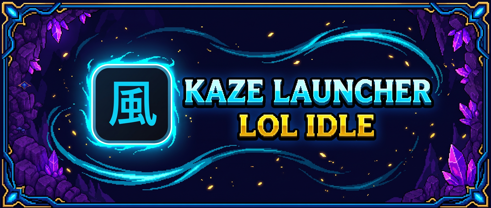
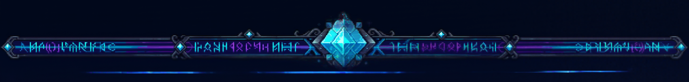

 

 

 
 

  &nbsp;
  &nbsp;
  &nbsp;
  

  &nbsp;
  &nbsp;
  &nbsp;
  

  

  
   
  <em>Kaze Launcher rodando LoL Idle com sessões isoladas, Build Planner e ferramentas integradas.</em>

  

## Português (BR)

Canal oficial de distribuição do **Kaze Launcher** para Windows x64. Um cliente desktop dedicado para jogar **LoL Idle** com múltiplas contas isoladas, controle de proxy, otimização de RAM e ferramentas analíticas integradas.

###  &nbsp;Download

  

 

Escolha o formato desejado nos **Assets** da última release:

| Arquivo | Formato | Indicação |
| :--- | :---: | :--- |
| `Kaze.Launcher-Setup-0.8.8-x64.exe` | **Setup** | Cria atalhos no Menu Iniciar e na Área de Trabalho, mantendo seus dados intactos em cada atualização **(recomendado)**. |
| `Kaze.Launcher-Portable-0.8.8-x64.exe` | **Portable** | Executável único para rodar diretamente de qualquer pasta, sem instalação. |

> [!NOTE]
> Por ser uma distribuição independente sem certificado digital comercial, o Windows SmartScreen pode exibir um alerta na primeira execução. Clique em **Mais informações** e depois em **Executar assim mesmo**.

### Recursos Principais

<table>
  <tr>
    <td width="50%" valign="top">
      
 &nbsp;<strong>Sessões Multi-Conta Isoladas</strong>

      
Grupos e contas ilimitadas com cookies, cache e zoom (<code>30%–200%</code>) independentes. Layouts flexíveis (<code>Auto</code>, <code>3+2</code>, grade personalizada até <code>4×4</code>, abas e modo foco) com paginação sem recarregar nenhuma conta.

    </td>
    <td width="50%" valign="top">
      
 &nbsp;<strong>Controle de IP e Proxies</strong>

      
<strong>Slot 0</strong> no seu IP real + proxies <strong>HTTP, HTTPS e SOCKS5</strong> com <em>kill-switch</em> em 2 camadas, proteção contra vazamento WebRTC e contador mensal de banda por proxy.

    </td>
  </tr>
  <tr>
    <td width="50%" valign="top">
      
 &nbsp;<strong>Build Planner &amp; Hunt Analyzer</strong>

      
Três motores independentes alinhados ao LoL Idle: <strong>PvE</strong> (XP/h e Ouro/h), <strong>Dungeon</strong> (simulação das 7 Dungeons oficiais) e <strong>PvP 1v1</strong>. Inclui importação direta do personagem, comparador <strong>Build A vs B</strong> e <strong>Recomendação da Kaze</strong>.

    </td>
    <td width="50%" valign="top">
      
 &nbsp;<strong>Extensões por Conta &amp; Painel Lateral</strong>

      
Instale extensões via <code>.zip</code>, <code>.crx</code>, pasta <em>unpacked</em> ou importando do navegador. Já inclui <em>Hunt for LoL Idle</em> (<code>1zephzrx</code>) pronta para ativar por conta, com atalho <strong>Hunt</strong> acoplado lado a lado com o personagem.

    </td>
  </tr>
  <tr>
    <td width="50%" valign="top">
      
 &nbsp;<strong>Painel V/L: Votos e Lives da Twitch</strong>

      
Lives da Twitch via <strong>Chatterino 2</strong> portátil (~20 MB de RAM, sem vídeo) com redirecionamento direto dos links do jogo. Votação sem bloqueios em perfil isolado do navegador real (Chrome, Edge, Brave ou Firefox) usando o proxy da conta.

    </td>
    <td width="50%" valign="top">
      
 &nbsp;<strong>Otimização de RAM e Desempenho</strong>

      
Perfis de desempenho (<em>Automático</em>, <em>Ultra economia</em>, <em>Equilibrado</em> e <em>Desempenho</em>), hibernação opcional, <em>watchdog</em> e botão <strong>Otimizar Memória RAM</strong> com limpeza automática a cada <strong>60 minutos</strong> sem perder logins ou cookies.

    </td>
  </tr>
  <tr>
    <td width="50%" valign="top">
      
 &nbsp;<strong>Atualização Automática em 1 Clique</strong>

      
Verifica novas versões em segundo plano com validação criptográfica <strong>SHA-512</strong> (<code>latest.yml</code>) e separação estrita entre <strong>Setup</strong> e <strong>Portable</strong>. Basta clicar em <strong>Atualizar · Reiniciar</strong> dentro do app.

    </td>
    <td width="50%" valign="top">
      
 &nbsp;<strong>Privacidade Local, Temas e Backup</strong>

      
6 temas prontos + editor personalizado, idiomas <strong>PT-BR / EN</strong>, paleta <code>Ctrl+K</code>, cofre de senhas opcional (<code>AES-256-GCM</code>) e backups JSON criptografados. Todos os dados ficam exclusivamente em <code>%APPDATA%/Kaze</code>.

    </td>
  </tr>
</table>

###  &nbsp;Créditos e Contato

<table>
  <tr>
    <td width="50%" valign="middle">
       &nbsp;<strong>Kaze Launcher:</strong> criado por <strong>taki</strong> · Discord: <code>justviole</code>
    </td>
    <td width="50%" valign="middle">
       &nbsp;<strong>Hunt for LoL Idle:</strong> créditos a <strong>1zephzrx</strong> · Discord: <code>1zephzrx</code>
    </td>
  </tr>
</table>

<a href="#top">Voltar ao topo ↑</a>

  

## English (US)

Official distribution channel for **Kaze Launcher** (Windows x64). A dedicated desktop client for **LoL Idle** featuring isolated multi-account sessions, proxy control, RAM optimization, and built-in analytical tools.

###  &nbsp;Download

  

 

Choose your preferred format under **Assets** on the latest release page:

| File | Format | Best For |
| :--- | :---: | :--- |
| `Kaze.Launcher-Setup-0.8.8-x64.exe` | **Setup** | Creates Start Menu and Desktop shortcuts while keeping your data intact across updates **(recommended)**. |
| `Kaze.Launcher-Portable-0.8.8-x64.exe` | **Portable** | Single executable that runs directly from any folder with no installation required. |

> [!NOTE]
> Because this independent build is not signed with a commercial certificate, Windows SmartScreen may show a warning on first launch. Click **More info**, then **Run anyway**.

### Key Features

<table>
  <tr>
    <td width="50%" valign="top">
      
 &nbsp;<strong>Isolated Multi-Account Sessions</strong>

      
Unlimited groups and accounts with separate cookies, cache, and zoom (<code>30%–200%</code>). Flexible layouts (<code>Auto</code>, <code>3+2</code>, custom grids up to <code>4×4</code>, tabs, and focus mode) with reload-free pagination.

    </td>
    <td width="50%" valign="top">
      
 &nbsp;<strong>IP Control &amp; Proxies</strong>

      
<strong>Slot 0</strong> on your real IP + <strong>HTTP, HTTPS, and SOCKS5</strong> proxies with a 2-layer kill-switch, WebRTC leak protection, and monthly per-proxy bandwidth tracking.

    </td>
  </tr>
  <tr>
    <td width="50%" valign="top">
      
 &nbsp;<strong>Build Planner &amp; Hunt Analyzer</strong>

      
Three independent engines aligned with LoL Idle: <strong>PvE</strong> (XP/h &amp; Gold/h), <strong>Dungeon</strong> (all 7 official Dungeons), and <strong>PvP 1v1</strong>. Includes live character import, <strong>Build A vs B</strong> comparator, and <strong>Kaze Recommendation</strong>.

    </td>
    <td width="50%" valign="top">
      
 &nbsp;<strong>Per-Account Extensions &amp; Side Panel</strong>

      
Load extensions from <code>.zip</code>, <code>.crx</code>, unpacked folders, or browser import. Ships with <em>Hunt for LoL Idle</em> (<code>1zephzrx</code>) ready to toggle per account via the docked <strong>Hunt</strong> side-by-side panel.

    </td>
  </tr>
  <tr>
    <td width="50%" valign="top">
      
 &nbsp;<strong>V/L Panel: Votes &amp; Twitch Lives</strong>

      
Twitch chat via portable <strong>Chatterino 2</strong> (~20 MB RAM, no video decoding) with automatic redirect from in-game stream links. Block-free voting inside an isolated real browser profile (Chrome, Edge, Brave, or Firefox) using the account's proxy.

    </td>
    <td width="50%" valign="top">
      
 &nbsp;<strong>RAM Optimization &amp; Performance</strong>

      
Performance profiles (<em>Automatic</em>, <em>Ultra Eco</em>, <em>Balanced</em>, and <em>Performance</em>), optional hibernation, watchdog, and a dedicated <strong>Optimize RAM</strong> button with automatic <strong>60-minute</strong> cleanup preserving logins and cookies.

    </td>
  </tr>
  <tr>
    <td width="50%" valign="top">
      
 &nbsp;<strong>1-Click Automatic Updates</strong>

      
Checks for new releases in the background with <strong>SHA-512</strong> checksum validation (<code>latest.yml</code>) and strict separation between <strong>Setup</strong> and <strong>Portable</strong> builds. Click <strong>Update · Restart</strong> inside the launcher to apply.

    </td>
    <td width="50%" valign="top">
      
 &nbsp;<strong>Local Privacy, Themes &amp; Backups</strong>

      
6 built-in themes + custom palette editor, live <strong>PT-BR / EN</strong> switching, <code>Ctrl+K</code> command palette, optional password vault (<code>AES-256-GCM</code>), and encrypted JSON backups. All data stays strictly local in <code>%APPDATA%/Kaze</code>.

    </td>
  </tr>
</table>

###  &nbsp;Credits & Contact

<table>
  <tr>
    <td width="50%" valign="middle">
       &nbsp;<strong>Kaze Launcher:</strong> created by <strong>taki</strong> · Discord: <code>justviole</code>
    </td>
    <td width="50%" valign="middle">
       &nbsp;<strong>Hunt for LoL Idle:</strong> credits to <strong>1zephzrx</strong> · Discord: <code>1zephzrx</code>
    </td>
  </tr>
</table>

<a href="#top">Back to top ↑</a>

  

