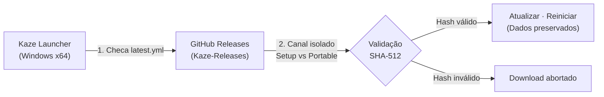

<!-- HERO BANNER -->

 

# 風 Kaze Launcher

<!-- ANIMATED TYPING SUBTITLE -->

  <strong>Canal oficial de distribuição e atualizações automáticas para Windows.</strong> 
  Official Windows installer &amp; automatic update distribution channel.

<!-- DYNAMIC LIVE BADGES -->

  
  
  
  
  

 

<!-- QUICK NAVIGATION BAR -->

  <a href="#pt-br"><strong>🇧🇷 Português (BR)</strong></a> &nbsp;·&nbsp;
  <a href="#en-us"><strong>🇺🇸 English (US)</strong></a> &nbsp;·&nbsp;
  <a href="https://github.com/pureza-discord/Kaze-Releases/releases/latest"><strong>⬇️ Download Latest</strong></a> &nbsp;·&nbsp;
  <a href="https://github.com/pureza-discord/Kaze-Releases/releases"><strong>📜 Changelog</strong></a>

---

## 🇧🇷 Português (BR)

Este repositório é o **canal público oficial** de distribuição de binários e manifestos de atualização automática do **Kaze Launcher** para Windows x64. O código-fonte permanece fechado e privado; os executáveis compilados são publicados e verificados aqui.

### ⬇️ Download

Na aba **Assets** da última release, escolha o formato ideal para o seu uso:

| Artefato | Formato | Recomendação |
| :--- | :---: | :--- |
| `Kaze.Launcher-Setup-<versão>-x64.exe` | **Instalador (Setup)** | Cria atalhos no Menu Iniciar e Área de Trabalho e mantém todos os seus dados intactos nas atualizações **(recomendado)**. |
| `Kaze.Launcher-Portable-<versão>-x64.exe` | **Portátil (Portable)** | Executável único para rodar diretamente de qualquer pasta ou pendrive, sem instalação no sistema. |

> [!NOTE]
> **Aviso do Windows SmartScreen:** por ser uma distribuição independente sem certificado comercial EV, o Windows pode exibir um alerta na primeira execução. Clique em **Mais informações → Executar assim mesmo**.

<strong>⚙️ Requisitos do Sistema &amp; Armazenamento Local</strong>

 

* **Sistema Operacional:** Windows 10 ou Windows 11 (64-bit / x64).
* **Armazenamento de Dados:** 100% local em `%APPDATA%\Kaze` (sessões, perfis, credenciais e backups JSON criptografados).
* **Integração de Votos (opcional):** Chrome, Edge, Brave ou Firefox instalado para abertura de perfil isolado com proxy.

---

### 🔄 Arquitetura de Atualização Automática

Você só precisa baixar o instalador manualmente **uma única vez**. A partir daí, o próprio launcher cuida de todo o ciclo de atualização com integridade criptográfica:

* **Verificação em segundo plano:** detecta novas releases automaticamente sem interromper sua sessão.
* **Integridade via SHA-512:** cada binário é validado contra o manifesto `latest.yml`, mantendo builds **Setup** e **Portable** estritamente separadas.
* **Zero perda de dados:** ao clicar em **Atualizar · Reiniciar**, suas contas, proxies, extensões e configurações permanecem intactos.

---

### ✨ Recursos Principais

<table>
  <tr>
    <td width="50%" valign="top">
      <h4>🪟 Sessões Multi-Conta Isoladas</h4>
      Grupos e contas ilimitadas com cookies, cache e zoom (<code>30%–200%</code>) totalmente independentes. Layouts flexíveis (<code>Auto</code>, <code>3+2</code>, grade customizada até <code>4×4</code>, abas e modo foco) com paginação sem recarregar contas.
    </td>
    <td width="50%" valign="top">
      <h4>🛡️ Controle de IP &amp; Proxies</h4>
      <strong>Slot 0</strong> (IP real) + suporte a proxies <strong>HTTP / HTTPS / SOCKS5</strong> com <em>kill-switch</em> em 2 camadas, proteção contra vazamento WebRTC e contador mensal de tráfego por proxy.
    </td>
  </tr>
  <tr>
    <td width="50%" valign="top">
      <h4>⚔️ Build Planner &amp; Hunt Analyzer</h4>
      3 motores independentes para LoL Idle (<strong>PvE</strong>, <strong>Dungeon</strong> com as 7 Dungeons oficiais e <strong>PvP 1v1</strong>), importação direta do personagem, comparador <strong>Build A vs B</strong> e <strong>Recomendação da Kaze</strong>.
    </td>
    <td width="50%"
